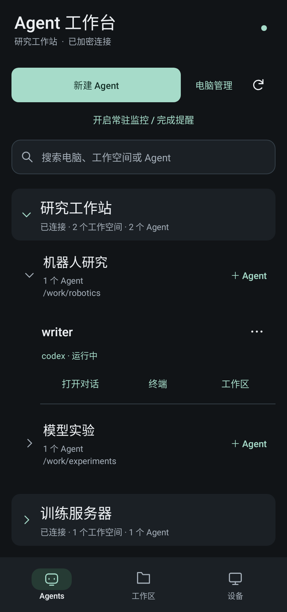
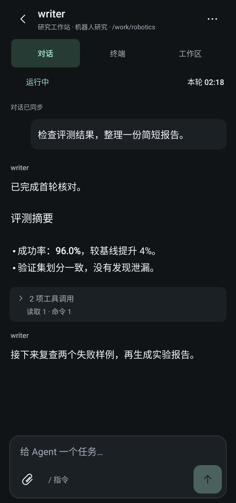
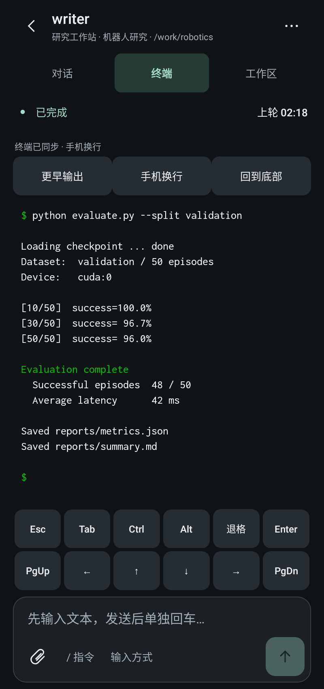
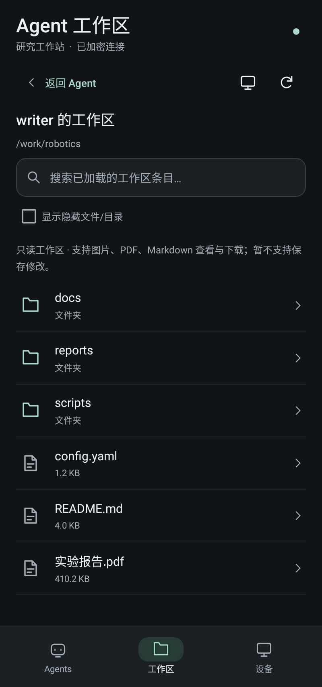

# Herdr Relay Extra + Herdr Pocket

<!-- pocket-preview:start -->
<table>
  <tr>
    <td align="center" valign="top" width="25%">
      <a href="images/pocket/agents.png"></a>
      <br /><sub>电脑与工作空间分组</sub>
    </td>
    <td align="center" valign="top" width="25%">
      <a href="images/pocket/conversation.png"></a>
      <br /><sub>原生对话与工具折叠</sub>
    </td>
    <td align="center" valign="top" width="25%">
      <a href="images/pocket/terminal.png"></a>
      <br /><sub>终端与附加按键</sub>
    </td>
    <td align="center" valign="top" width="25%">
      <a href="images/pocket/workspace.png"></a>
      <br /><sub>工作区文件浏览</sub>
    </td>
  </tr>
</table>

<sub>0.2.23 界面预览 · 使用演示数据的原生控件渲染，点击查看大图。</sub>
<!-- pocket-preview:end -->

当前可配套使用的 **Relay 源码 + 原生 Android App 源码**。APK 及编译好的 Linux Relay/Gateway 通过本仓库的 **GitHub Releases** 发布，不存放在 Git 仓库目录中。

| 组件 | 版本 | 位置 |
| --- | --- | --- |
| 电脑 Relay | `0.23.5+codexfix.11` | 仓库根目录，`cmd/herdr-mobile-relay` |
| 原生 TCP Gateway | `0.23.5+codexfix.6` | `cmd/herdr-gateway`，`deploy/native-tcp/` |
| Herdr Pocket Android | `0.2.23` / versionCode `26`（本地构建） | `herdr-android/` |

本次按当前可用源码快照替换此前根目录的 0.24.0 文件扩展实现，不把两条不同基线混为同一版本。组件对应关系及源码来源见 [VERSION.json](VERSION.json)。旧内容仍可从 Git 历史查看。

## 下载 Android APK

**0.2.23 为本地构建，尚未发布 Release**，新增电脑/工作空间两级折叠、状态记忆及搜索临时展开；不影响多电脑连接和后台完成提醒，沿用原签名与配对。[分组说明](herdr-android/AGENT-GROUPS.md)。下面的 0.2.22 仍是已发布版本。

0.2.22 发布于 **`android-v0.2.22`**（2026-11-04），包含终端改进：补载历史的进度/阅读位置、明确上游没有更多行的提示、参考 Termux 的退格/回车/方向/翻页/Ctrl/Alt 附加键；[终端使用说明与限制](herdr-android/TERMINAL.md)。包含此前 0.2.21 UI 打磨：按 Impeccable 的原生指南统一深色配色、排版与交互层级，简化 Agent 分组、对话状态/输入区，改善文件页和大屏导航。既有功能、Relay/Gateway 与配对保留；[设计说明](herdr-android/DESIGN.md)。APK 为 `Herdr-Pocket-0.2.22-debug.apk`，附 `SHA256SUMS.txt`；源码通过该 tag 的 Source code 下载项获取。

0.2.20 发布于 **`android-v0.2.20`**：保存后核对实际文件名，尝试恢复原名并重新验证；不支持改名、命名冲突或无法确认时明确提示。包含此前未单独发布的 0.2.18/0.2.19 修复：正确匹配保存/分享 MIME，不把发布标签或仓库名当作工作区文件，文件不存在时显示实际读取路径。只需更新 App，**Relay/Gateway 无需更新或重启**。详见[文件访问与保存说明](docs/file-access.md)。

0.2.17 / Relay codexfix.11：保留中途对话漏补修复，新增超限文件下载、通用文件链接和可选工作区外只读访问（[使用与安全边界](docs/file-access.md)）。对应发布为 `android-v0.2.17` 与 `native-v0.23.5-codexfix.11`。包含此前 0.2.16 / codexfix.10 的本地修复，不单独发布中间版本。

0.2.15 与 Relay codexfix.9 配套修复工作区目录缺失，改为逐层分页读取，支持隐藏文件开关。[修复详情及接口边界](docs/workspace-directory.md)。已有 Gateway codexfix.6 无需更新。

0.2.14 修复图片读取中断后不补载的问题：重连或回到前台后自动恢复可见预览，合并重复请求，保留已读历史和图片缓存。

0.2.13 包含完成提醒声音检查/测试入口及此前 0.2.12 本地构建的工作空间标题修复。

进入仓库 **Releases → Herdr Pocket 0.2.22**，下载 `Herdr-Pocket-0.2.22-debug.apk`。

- Android 9 / API 28 及以上。
- 与此前同签名的 Pocket APK 可直接覆盖安装，**不需要重新配对**。
- 发布包使用调试签名，不是 Play 商店版本；签名私钥不随源码发布。自己构建的 debug APK 通常使用不同签名，不要为了覆盖安装而直接卸载含配对/草稿的旧 App。
- Release 同时提供 SHA-256 校验文件，源码由对应 Git tag 的 Source code 下载项提供。
- 用旧版 App 下载本次 APK 若仍显示 `.bin`，这一次先将完整名称改为 `Herdr-Pocket-0.2.22-debug.apk` 再安装。

## CI 构建与固定签名

Actions 的 `build-artifacts` 提供三平台 Relay/Gateway 和三种 ABI 的 Android 构建。
现有主分支 `feat/android-file-companion` 的可信构建通过独立签名任务使用原有 Pocket 证书，
产物为 `android-apks-signed`；PR/其他分支仅提供 `android-apks-ci`，不能当作现有 App 的覆盖安装包。
产物保留一天，不自动发布或替换 Release。详见[构建、签名与密钥管理](docs/native-ci.md)。

## 下载 Relay / Gateway 与部署指南

**[完整部署指南：从零安装 → systemd → 配对 → 升级/回滚](docs/native-deployment.md)**

- 公网服务器装 **Gateway**；运行 Herdr/Agent 的电脑以同一用户装 **Relay**；手机装 APK。
- 服务端 Release **`native-v0.23.5-codexfix.11`** 提供 Linux x86_64 / amd64：
  - `herdr-mobile-relay_0.23.5-codexfix.11_linux_amd64.tar.gz`
  - `herdr-gateway_0.23.5-codexfix.6_linux_amd64.tar.gz`
  - `SHA256SUMS.txt`
- 包含二进制、配置/systemd 模板、初始化工具、部署说明和构建来源；无需在目标机器安装 Go。
- 公网业务只需 **8377/TCP**，原生 App 不要求域名/HTTPS；应用数据使用现有 E2EE。健康端口仅 loopback。
- 只更新二进制时保留原密钥和设备库，**不重启 Herdr/Agent**。已有安装先读指南的升级章节，不重复初始化。
- 此服务端 Release 独立于 Android `android-v0.2.22`；Android 保持 Latest。本次未提供 ARM64/macOS/Windows 二进制。

## 已实现

- 工作空间 / Tab 分组与可靠会话定位，修复恢复后的 Codex 历史读取。
- 原生对话、连续工具调用的两层折叠、历史分页/缓存/加载反馈。
- 手机适配终端字体和滚动历史。
- 图片缩放、PDF/Markdown 全屏查看与通用本地文件引用；超限文件仍可下载/分享，支持进度与取消。
- 可选的工作区外只读浏览/预览/下载：默认关闭，按手机凭据在 Relay 端授权，设备页可随时关闭。
- 大图/工具结果挤出近期日志窗口时补回中间文字和看图调用，保持在工具双层折叠外。
- 指定工作空间新建 Agent、重命名；Codex 模型/思考强度按会话切换，下一轮生效。
- 对话顶部运行状态及真实本轮计时，不以打开页面或最后输出时间代替开始时间。
- **App 内常驻监控**：开启后默认关注全部 Agent，新 Agent 自动纳入，可单独关闭完成提醒。原生通知、按轮次去重、点击回到确切会话；可测试完成提醒并直接进入声音设置。
- **纯 IP + TCP** 或既有 HTTPS/WSS：应用消息沿用设备鉴权和 E2EE，原生模式不需要域名/证书。

## 构建电脑 Relay / Gateway

需要 `go.mod` 指定的 **Go 1.27.3**。首次构建需要下载依赖。
完整 Linux 归档使用 `scripts/package-native-release.sh 新输出目录`，然后 `python3 scripts/check-native-release.py 输出目录`；以下命令只构建单个可执行文件。

```bash
mkdir -p bin
CGO_ENABLED=0 go build -trimpath \
  -ldflags '-s -w -X main.version=0.23.5+codexfix.11 -X main.revision=source-build' \
  -o bin/herdr-mobile-relay ./cmd/herdr-mobile-relay
CGO_ENABLED=0 go build -trimpath \
  -ldflags '-s -w -X main.version=0.23.5+codexfix.6 -X main.revision=source-build' \
  -o bin/herdr-gateway ./cmd/herdr-gateway

go test -p 1 ./...
go vet ./...
```

Android 构建需要 JDK 21、Android SDK 35 / Build Tools 35.0.0；Gradle Wrapper 固定为 8.14.6：

```bash
cd herdr-android
export JAVA_HOME=/path/to/jdk-21
export ANDROID_HOME=/path/to/android-sdk
./gradlew --no-daemon testDebugUnitTest assembleDebug assembleDebugAndroidTest lintDebug
```

APK 输出：`herdr-android/app/build/outputs/apk/debug/app-debug.apk`。

## 部署与配对

- 电脑 Relay 安装在运行 Herdr、保存项目/会话的电脑上；公网服务器只部署 Gateway。
- 原生 TCP 业务仅需 **一个公网 TCP 端口 8377**，SSH 另作维护；Gateway HTTP 健康检查绑定 loopback，STUN 可关闭。
- 示例地址只用于文档，必须换成自己的服务器。不要把运行时 `relay.env`、注册秘密、设备凭据、完整邀请链接或二维码提交到仓库。
- `herdr-mobile-relay tcp-pair [设备名]` 通过正在运行的 Relay 的私有 Unix socket 创建限时设备邀请；调用时加载该 Relay 的环境配置。不要用另一进程直接写活跃的设备库。
- 仅更新本地扩展二进制时，不要重启正在工作的 Herdr/Agent；先备份配置，只重启 Relay。

[原生 TCP 配置与安全边界](docs/native-tcp.md) · [Agent 管理与模型设置](docs/agent-management.md) · [状态及计时](docs/agent-run-state.md) · [后台监控说明](herdr-android/BACKGROUND-MONITORING.md)

## 通知与安全边界

常驻监控需要用户开启、允许通知，通知栏提供停止按钮；可增加耗电。Android Doze、厂商省电、强行停止或断网仍可能延迟/漏报。**这是手机常驻连接，不是 FCM/厂商云推送。**目前未进行用户真机锁屏验收。

TCP 本身不加密，应用数据由现有 ECDH/HMAC/AES-GCM E2EE 保护；路由/握手元数据、地址、大小和时序仍可见。未关闭原 HTTPS/WSS 证书校验，也未做独立安全审计。

验证记录：226 个 Android JVM/Robolectric 测试通过，真实本地 TCP+E2EE fixture 覆盖后台监控/静音/重连、超限文件下载/分享、工作区外权限切换、文件链接与系统保存后恢复原名；Relay codexfix.11 的 Go 全套 tests/vet 和 workspace/deviceauth/app/protocol race 检查通过。详细范围与未验证项见 [Android VALIDATION.md](herdr-android/VALIDATION.md)。

## 许可证与历史代码

遵循仓库 [LICENSE](LICENSE) 和第三方各自许可证；Android 依赖/引用来源见 [THIRD_PARTY.md](herdr-android/THIRD_PARTY.md)。保留上游 Go module 路径用于内部导入，不代表本分支由上游发布。

`web/` 是当前 Relay 配套的原始生成快照，未手工改写 JS/压缩产物；手机 App 不使用此网页作为 Agent UI。`QUICKSTART.md`、上游 CI 和部分网页文档仍保留上游工作流；本地扩展发布以本首页和 VERSION.json 为准，Android release tag 使用 `android-v...`，不触发上游 `v*` 插件发布流水线。
